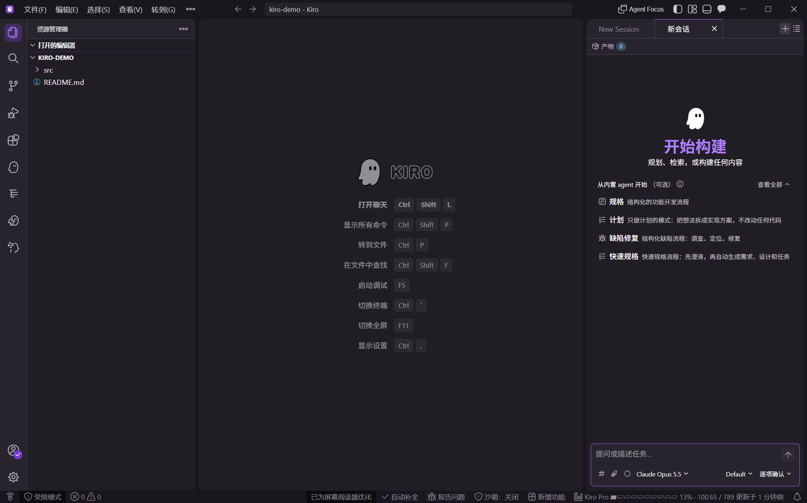
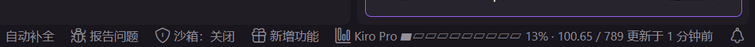

# kiro-zh · Kiro 界面汉化


把 [Kiro](https://kiro.dev) IDE 的自绘界面（聊天面板、设置项、状态栏、权限模式、内置模式、额度条）改成简体中文，并可选给额度加上百分比与进度条。纯本地脚本，只改展示字符串，不动账号数据与业务逻辑。

**非官方项目**，与 Kiro / AWS 无关。改的是安装目录里的文件，Kiro 升级会覆盖，升级后重跑一次即可。

## 效果

| 位置 | 原样 | 汉化后 |
|---|---|---|
| 顶部菜单 | File / Edit / View | 文件 / 编辑 / 查看 |
| 聊天输入区 | Ask a question or describe a task... | 提问或描述任务... |
| 权限模式 | Supervised / Accept file changes / Approve for me | 逐项确认 / 自动接受文件修改 / 自动批准 |
| 内置模式 | Default / Spec / Quick Spec / Bug Fix | 默认 / 规格 / 快速规格 / 缺陷修复 |
| 设置项说明 | 英文长段落 | 中文长段落（含枚举项说明） |
| 状态栏 | Autocomplete / Sandbox: Off / What's new | 自动补全 / 沙箱：关闭 / 新增功能 |
| 欢迎页（登录页组件） | Open a project / Clone repository / Connect to | 打开项目 / 克隆代码库 / 连接到 |
| 额度 | Kiro Pro 82.68 / 789 updated just now | Kiro Pro ▰▱▱▱▱▱▱▱▱▱ 10% · 82.68 / 789 更新于 刚刚 |

## 截图





截图在空项目里截取，不含个人路径与账号信息；`Claude Opus 5.5` 等模型名、个别由服务端下发的名称保持英文。

## 快速开始

前置：Windows，已装 Kiro，已装简体中文语言包（`ms-ceintl.vscode-language-pack-zh-hans`），Python 3.9+。

不想装 Python 就用 Release 里的单文件版（[下载最新版](https://github.com/melvin688/kiro-zh/releases/latest)）：

```text
kiro-zh.exe                      双击 → 回车开始汉化
kiro-zh.exe verify               验收
kiro-zh.exe translate            补译语言包缺失条目（会提示粘贴 key，然后自动翻译→合并→烘焙）
kiro-zh.exe restore --list / --restore   回滚
```

首次运行会被 SmartScreen 拦截（未签名）：更多信息 → 仍要运行。

源码方式：

```bash
# 1. 预演：只探测路径，不写文件
python scripts/apply.py --dry-run

# 2. 执行：汉化 + NLS 烘焙 + 校验值回填 + 清缓存 + 重启
python scripts/apply.py
```

找不到安装目录时显式指定：

```bash
python scripts/apply.py --app "C:/Users/<你>/AppData/Local/Programs/Kiro/resources/app"
```

回滚：

```bash
python scripts/restore.py --app "<同上>" --list     # 看哪些文件能回滚
python scripts/restore.py --app "<同上>" --restore  # 执行回滚
```

## 脚本

| 脚本 | 作用 |
|---|---|
| `scripts/apply.py` | 一键编排，默认四步全做并重启 |
| `scripts/patch_ui.py` | 自绘 UI 的英文字面量直替换（菜单、聊天、模式、状态栏、沙箱、额度百分比、密度） |
| `scripts/localize_nls.py` | 把语言包中文烘焙进 `out/nls.messages.json/.js`，并清理 `%APPDATA%/Kiro/clp` 缓存 |
| `scripts/fix_checksums.py` | 重算 `product.json` 校验值，消除「安装似乎损坏」告警 |
| `scripts/asar_tool.py` | 读写 `node_modules.asar`：列可见文案、做等长字节替换（欢迎页/登录页） |
| `scripts/translate_missing.py` | `chunks` 导出缺失条目 / `auto` 调 OpenAI 兼容接口批量翻译 / `merge` 合并回语言包（占位符校验） |
| `scripts/restore.py` | 按 `.zhbak` 备份回滚 |
| `scripts/verify.py` | 冒烟验收：关键中文串是否在位 + `node --check` 语法检查 |
| `packaging/kiro_zh.py` | 单文件入口：`apply` / `verify` / `restore`，PyInstaller 打包用 |
| `packaging/build.ps1` | 本机打包 `dist/kiro-zh.exe`（uv + Python 3.12 + PyInstaller） |

常用参数：`--dry-run` 只探测、`--no-restart` 不重启、`--skip-nls` 只改字面量、`--skip-ui` 只做 NLS。

## 补齐语言包缺失条目

Kiro 自带的中文语言包覆盖不到它自己新增的设置说明和命令描述。脚本能把缺失条目找出来，调任意 OpenAI 兼容接口批量翻译，再写回语言包。

```bash
export KIRO_ZH_API_KEY=sk-...                    # 也认 DEEPSEEK_API_KEY / OPENAI_API_KEY
python scripts/translate_missing.py auto --out ./work      # 默认 DeepSeek
python scripts/translate_missing.py auto --api-url http://127.0.0.1:8000/v1 --model qwen2.5-14b
python scripts/translate_missing.py merge --out ./work     # 写回语言包，自动备份 .zhbak
python scripts/apply.py                                    # 烘焙 NLS + 重启
```

- 按约 6000 字符切块、默认 4 并发；已有 `nls_out_*.json` 的块直接跳过，可断点续跑，`--limit N` 控制本轮只译几块。
- 每块校验占位符（`{0}` `%s` `$(icon)` `${var}` `<tag>`）与空值，不合格的条目带错误信息重发一次，仍不合格就不写入。
- 不调 API 也能用：`chunks` 导出 `nls_chunk_*.json` + `RULES.txt`，人工或别的工具译好后另存 `nls_out_<n>.json`，再走 `merge`。

## 为什么需要两套汉化

Kiro 的界面文案有三个来源，只改一处不够：

1. **官方语言包** `main.i18n.json`：按「模块 + key」取文案的老式代码生效，覆盖多数原生 UI。
2. **NLS 消息表** `out/nls.messages.json`：workbench / sessions 渲染进程用 `localize(index)` 读这张扁平数组，语言包改了也不生效，必须把中文烘焙进数组本身，并清掉 `%APPDATA%/Kiro/clp` 缓存。
3. **硬编码字面量**：聊天面板（React bundle）、权限模式、额度文案、状态栏项都在 minified bundle 里写死英文，只能按字面量替换。
4. **asar 内的页面**：欢迎页 / 登录页（`@kiro/sign-in-page`）打包在 `node_modules.asar`，改的是容器里的文件字节，必须等长替换才不破坏 asar 结构。

细节见 [docs/原理.md](docs/原理.md)。

## 风险与边界

- 改的是安装目录，Kiro 自动更新会覆盖，**升级后重跑 `apply.py`**。
- 所有文件首次改写前生成同名 `.zhbak`，`restore.py` 可完整回滚。
- 改 `out/` 下被校验的文件会触发完整性告警，已在同一流程里回填 `product.json` 校验值。
- 后端/模型生成的内容不受本工具控制：工具调用摘要（`3 tool calls`）、会话标题可能是英文。仓库附带 `assets/steering/zh-ui.md`，作为 Kiro 全局 steering 让生成的标题与摘要走中文。
- 不支持 macOS / Linux（路径探测与重启逻辑是 Windows 的，欢迎 PR）。

## English

`kiro-zh` localizes the self‑drawn UI of the [Kiro](https://kiro.dev) IDE — chat panel, settings descriptions, status bar, approval modes, built‑in modes, usage meter and welcome page — into Simplified Chinese, and optionally adds a percentage plus progress bar to the usage meter.

Unofficial, not affiliated with Kiro or AWS. It rewrites strings inside the install directory, so a Kiro update restores the English UI; just re‑run the script afterwards.

Requirements: Windows, Kiro installed, `ms-ceintl.vscode-language-pack-zh-hans`, Python 3.9+.

```bash
python scripts/apply.py --dry-run    # probe paths, write nothing
python scripts/apply.py              # patch, bake NLS, fix checksums, restart
python scripts/verify.py             # smoke check
python scripts/restore.py --restore  # roll back from .zhbak files
```

## 兼容版本

已实测：Kiro **1.4.178**（内嵌 VS Code 1.131.0），Windows 11。

**Linux**：在 WSL2 Ubuntu 24.04（Python 3.12）上跑通 21 条单测，并用宿主的英文原件副本走完整替换链——57 条命中、3 个 `.zhbak` 生成、`find_app_root` / `exe_path` / `data_dir`（`$XDG_CONFIG_HOME/Kiro`）都定位正确。没有装 Kiro 的 Linux 版，所以「启动后界面变中文」这步未验证。

**macOS**：只有代码与单测（合成的 `Kiro.app/Contents/{Resources/app,MacOS/Kiro}` 布局），**没有实机**，也没有 Apple 机器可借。

非 Windows 首次使用建议先 `kiro-zh apply --dry-run` 看路径探测结果。

额度百分比补丁依赖具体 minified 符号，换版本后可能未命中（脚本会提示，其余汉化不受影响）。其余字面量替换按内容匹配，版本容忍度较高。

## 开发

```bash
python -m py_compile scripts/*.py     # 语法
python -m unittest discover -s tests -v   # 离线单测（不依赖 Kiro）
python scripts/apply.py --dry-run     # 路径探测
python scripts/verify.py              # 汉化体检
```

路线图：

- [x] 版本自适应：额度函数按 `Bonus` / `currentOverages` 锚点 + 模板正则定位，Kiro 升级重命名符号后仍能命中
- [x] 差额翻译自动补全：`translate_missing.py auto` 调 OpenAI 兼容接口批量译缺失条目，占位符校验 + 失败重试，再 `merge` 回语言包
- [x] PyInstaller 打包成单文件 exe，免装 Python（`packaging/`，Release 附件）
- [x] Linux / macOS 支持：路径探测、数据目录、重启逻辑按平台分支；Linux 在 WSL2 上跑了单测与整链替换，macOS 仅单测（无实机）

## 许可

MIT，见 [LICENSE](LICENSE)。
